# Terminal Mastery — Full System Audit

> **→ [BACKLOG.md](BACKLOG.md)** — the sequenced fix plan built from this doc. Start there when you're ready to act.

> **Companion doc:** [AUDIT-SCREENS.md](AUDIT-SCREENS.md) — the screen-by-screen walkthrough covering marketing, positioning, conversion, clarity and visual distinctiveness. This doc covers system-level defects; that one covers how each screen performs for a visitor.

**Date:** 19 October 2026 · **Method:** app run locally at `localhost:3000`, every screen walked by hand, all 20 lessons parsed from source. Screenshots in [`audit-screenshots/`](audit-screenshots/).

---

## Verdict first

The content is the asset and it's worth keeping. The shell around it has about a dozen specific defects, most of them small and fixable. The one structural problem is that **the product promises interactive practice and doesn't deliver it** — everything else is cleanup.

Findings are tagged:

- 🔴 **Broken** — defective now, users hit it
- 🟡 **Dated** — worked, but below where you'd set the bar today
- 🔵 **Rethink** — a deliberate past choice worth revisiting

Severity assumes the goal is sending real traffic here.

---

## 🔴 Broken

### B1. Lesson 8 ships two visibly broken screens
`src/data/lessons.ts` — the lesson 8 object is the only one of 20 with **no `quiz` key and no `summary` key**.

The stepper hardcodes its step count as `1 + commands.length + 1 + 1 + 1` (`src/app/lessons/[id]/page.tsx:127`), so it allocates a quiz step and a completion step regardless. Result:

- The quiz step renders the literal string **"Question 1 of"** — truncated, no question, no options, just a "Show Results" button. 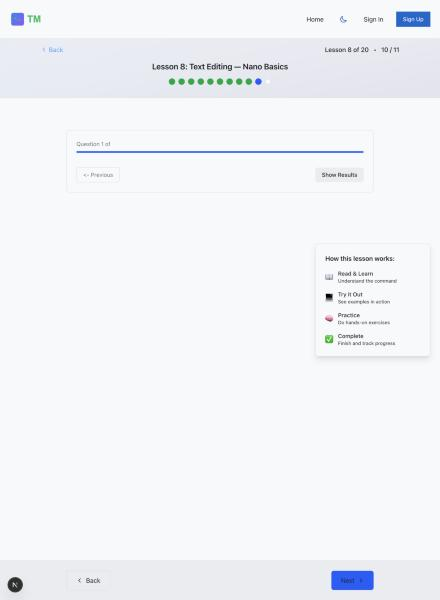
- The completion step falls back to "Great job completing this lesson!" where every other lesson shows real takeaways. 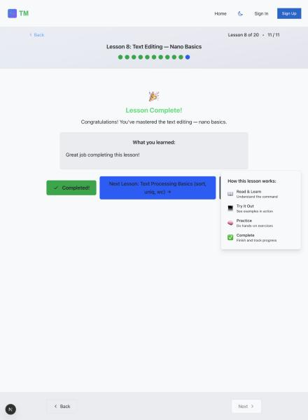

**Fix:** author the missing quiz + summary, and make `getStepCount` conditional so a lesson without a quiz doesn't get a quiz step.

### B2. `/completion` is unreachable by direct navigation or refresh
`src/app/completion/page.tsx:21-29` redirects when `completedLessons < totalLessons`. That guard runs before progress hydrates from localStorage, so on a cold page load it always sees 0.

Verified: with all 20 lessons stored as complete, `localStorage` reporting `lessonsCompleted.length === 20`, navigating straight to `/completion` lands on `/lessons`. It only works when reached by in-app client-side navigation.

Anyone who bookmarks, refreshes, or shares the completion URL is bounced away from the one reward the course offers.

**Fix:** gate on a `hydrated`/`isLoading` flag before evaluating the redirect.

### B3. The walkthrough card overlaps and obscures lesson content
`src/components/ui/LessonWalkthroughCard.tsx` floats bottom-right over the content column on desktop. It isn't decorative-only — it covers real content and real controls:

- On command steps it hides the right edge of the example explanation. 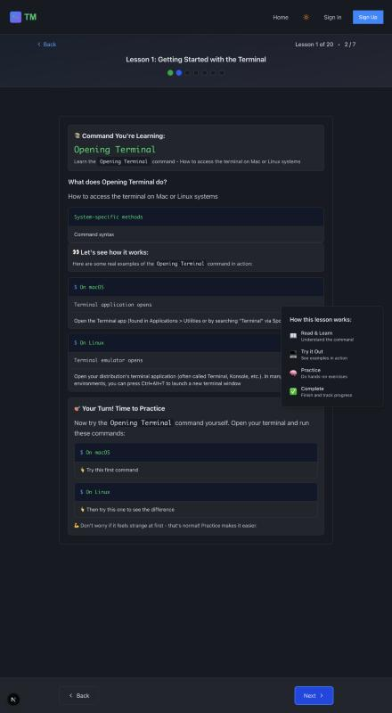
- On the final step it sits **on top of the "Lessons" button**, an interactive control. 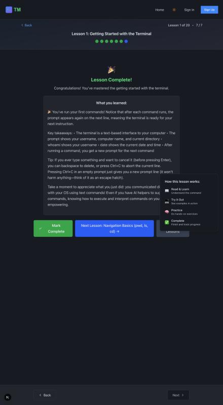

It's also pure decoration — a hardcoded 4-item array (`:14-35`) with no lesson data flowing into it. It costs you a control and teaches nothing.

**Fix:** move it into the flow as a one-time intro, or delete it. I'd delete it.

### B4. The quiz gates nothing and can be skipped entirely
I clicked "Next" straight past lesson 1's quiz without answering a single question and landed on "Lesson Complete!" 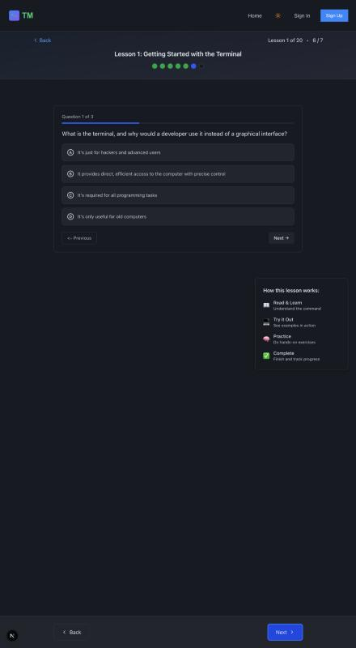

Compounding it:
- `updateQuizScore` (`src/context/AppContext.tsx:237-239`) is **never called by any component** — quiz results are discarded, nothing is stored.
- "Mark Complete" (`src/app/lessons/[id]/page.tsx:543-567`) has no precondition.
- The final step says "Lesson Complete! Congratulations! You've mastered…" *before* you click Mark Complete.

So the quiz is decorative. For a course whose selling point is "quick quizzes lock in the basics," that's the feature not existing.

### B5. Stored guest progress is mathematically corrupt
`src/context/AppContext.tsx:32` initialises `lessons: []` with the comment "Will be populated with actual lesson data." Nothing ever populates it — there's no `SET_LESSONS` action anywhere.

So the reducer computes `totalProgress` as `completed / 0` → **`Infinity`**, and writes that to localStorage on every completion.

It's currently masked because `/lessons` recomputes the percentage from static data (`src/app/lessons/page.tsx:18-20`), which is why the UI reads a correct "0 of 20 (0%)". But the persisted value is garbage, and anything that trusts it will misbehave.

### B6. The certificate has no name on it
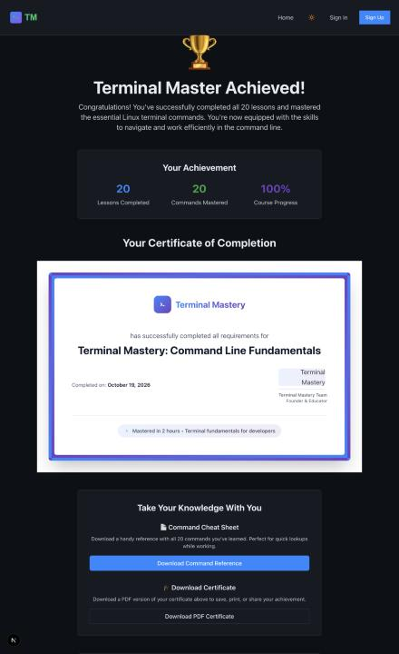

`src/app/completion/page.tsx:38` derives the name as `user.email.split('@')[0]`. There is no name field anywhere in signup (`AuthForm.tsx` collects email + password only) and `User` (`src/types/index.ts:58-63`) has no name property. So:

- Signed-in users get a certificate reading `hamza.saraswat`.
- Guests get a certificate with **a blank name**, as shown.
- It's dated `new Date()` — always today, never when you actually finished, even though `lesson_completions.completed_at` exists in the schema and `getCompletionStats` already reads it but is called from nowhere.
- `Certificate.tsx:9` accepts a `certificateId` prop and never renders it.
- `pdfGenerator.ts:149` prints a 🏆 emoji into a jsPDF helvetica run — not in the WinAnsi font set, so it renders as garbage in the downloaded PDF.

### B7. A fake "John Smith" certificate page is publicly routable
`/certificate` is live, unauthenticated, and crawlable (`robots.ts` allows everything but `/api/`). It renders two sample certificates for **"John Smith"** and **"developer@company.com"**, with a source comment reading "Sample data for testing — in production this would come from user session/database." 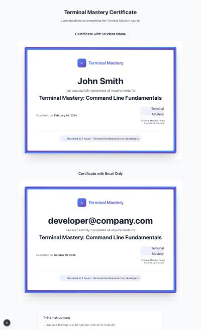

**Fix:** delete the route.

---

## 🟡 Dated

### D1. Lesson quality falls off a cliff after lesson 5
Parsed every lesson. Intro length, practice exercises, and hints by lesson:

| Lessons | Avg intro words | Practice exercises | Hints |
|---|---|---|---|
| 1–5 | 150 | 2–7 each | 6–21 each |
| 6–12 | 51 | 2–5 each | 5–19 each |
| 13–20 | 52 | **1–3 each** | 2–7 each |

Specifics: lesson 10's introduction is **16 words**. Lesson 9's is 22. Lessons 17, 18, 19 and 20 have **exactly one practice exercise each**. Lesson 1 has 190 words of intro and 2 exercises with 6 hints.

This is the classic shape of a project that ran out of steam — and it's the single biggest thing standing between this and a course you'd be proud to promote. The back half is an outline; the front half is a real course.

Totals across the set: 64 commands, 166 worked examples, 62 practice exercises, 56 quiz questions.

### D2. Every lesson claims "6 min" regardless of content
All 20 lessons hardcode `duration: 6`. It isn't an estimate — it's a constant. 20 × 6 = 120, which is exactly where the headline "under 2 hours" comes from.

Lesson 1 (190-word intro, 3 commands, 2 exercises, 3 quiz questions) is not the same length as lesson 20 (43-word intro, 1 exercise). Either compute it from content or stop showing per-lesson times.

### D3. Step 1 of every lesson is a wall of text
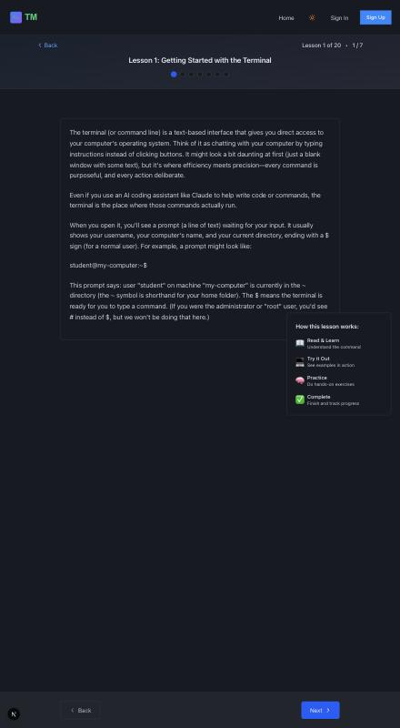

Lesson 1 opens with ~350 words of unbroken prose: no headings, no visual hierarchy, and the terminal prompt example `student@my-computer:~$` rendered as **plain body text** rather than in the `TerminalBlock` component you already built.

On mobile this is a single uninterrupted scroll of grey paragraphs — a rough first impression for a course sold on being beginner-friendly. 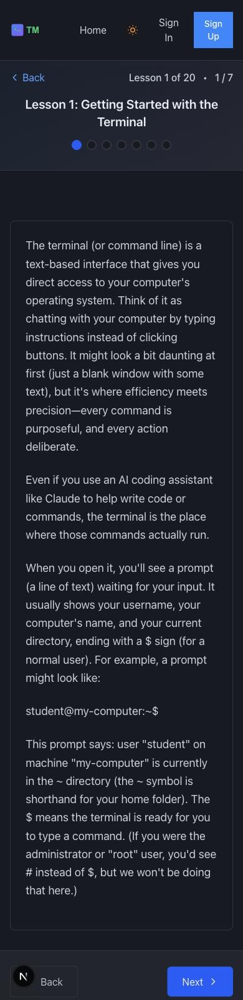

Note also the enormous dead vertical space below the content card on desktop: the card ends and ~600px of nothing follows before the footer nav.

### D4. The markdown renderer is hand-rolled and loses structure
`src/app/lessons/[id]/page.tsx:50-58, 67-73, 169-178` do regex string-replacement into `dangerouslySetInnerHTML`. Summary bullets must literally be `•` characters and paragraphs split on `\n\n`.

Visible consequence on the lesson-complete screen: "Key takeaways: • The terminal is a text-based interface • The prompt shows your username • whoami shows…" all runs together in one paragraph instead of rendering as a list.

You already depend on `react-markdown` + `remark-gfm` and have a `MarkdownContent` component. Use it.

### D5. Design tokens are bypassed in 81 places
The token system in `globals.css` is well built — two complete themes, `@theme inline` wiring, sensible naming. Then 81 raw Tailwind palette classes ignore it (`bg-blue-600`, `text-green-400`, `bg-green-500`…), concentrated in `src/app/lessons/[id]/page.tsx` (**26 instances**) and `src/app/lessons/page.tsx` (6).

These don't respond to the theme toggle. The light theme works correctly today ([screenshot](audit-screenshots/16-light-theme-ok.jpg) — I checked, it's fine), but every hardcoded class is a future theme bug.

Related drift: **7 different border-radius values** in use (`rounded`, `-md`, `-lg`, `-xl`, `-2xl`, `-3xl`, `-full`) with no evident rule.

*(`text-gray-900` appears only in the certificate components, which are always on white — correct, not a bug.)*

### D6. `lessons/[id]/page.tsx` is 776 lines
One client component holding the stepper, quiz, practice, markdown parsing, auth gating and completion. It's the least token-compliant and most defect-dense file in the project — B1, B3, B4 and D4 all live here. Worth splitting whatever else you decide.

### D7. Accessibility gaps
- **0 uses of `focus-visible`**; 59 of plain `focus:`. Focus rings fire on mouse clicks too.
- `* { transition: background-color, color, border-color 0.3s }` in `globals.css:37-39` applies to **every element** with no `prefers-reduced-motion` guard.
- 28 `.floating-element` nodes animate continuously behind every page.
- Lesson prose goes in via `dangerouslySetInnerHTML`, so there's no semantic heading or list structure for screen readers.

### D8. Mobile header crowds
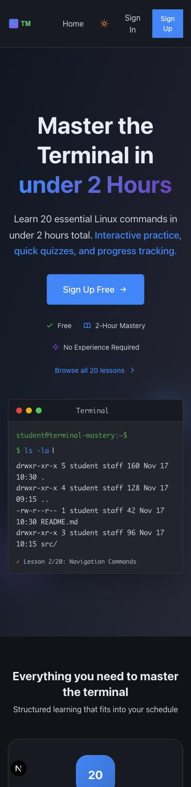 — at 390px "Sign In" wraps to two lines and the header is cramped. No hamburger pattern. The hero itself holds up well.

### D9. Hardcoded stats and a stale year
- `src/app/completion/page.tsx:72-85` — "20 / 20 / 100%" are string literals, not computed. "20 Commands Mastered" is also wrong on its own terms: the course teaches **64**.
- Footer reads "© 2025 Terminal Mastery". It's 2026.
- `src/data/lessons.ts:59` — lesson 1's `date` example output is frozen at `Tue Sep 21 20:38:31 CDT 2025`, visible on screen.

---

## 🔵 Rethink

### R1. The core promise isn't implemented
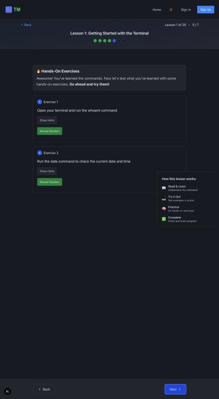

`FAQ.tsx:36`: *"Our interactive exercises let you practice real commands safely, with instant feedback."*

What exists: `grep '<input\|<textarea'` on the lesson page returns **nothing**. `TerminalBlock.tsx` is 51 lines of pure presentation. The practice step offers *Show Hints* and *Reveal Solution*, and tells you to go run the command in your own terminal.

Every practice exercise already carries an `expectedCommand` field — the data model for validation is there, unused. (There's also a dead `'observation'` sentinel check at `:307`; **zero** exercises in the data use that value.)

This is the fork in the road:

- **Build it** — a command input validating against `expectedCommand`, with real feedback. Delivers the promise and makes the product genuinely differentiated. Days of work, not hours.
- **Soften the copy** — call it a guided walkthrough with a cheat sheet. Still a legitimate, useful product. An hour.

Either is defensible. Shipping the current copy over the current product is not.

### R2. The all-or-nothing reward
`/completion` requires 20/20. 19 gets you nothing. Given D1 (the back half is thin), most people will never see the certificate at all. Milestones at 5 and 10 would reward the part of the course that's actually strong.

### R3. The cheat sheet is your best asset, locked in the worst place
`pdfGenerator.ts:4-84` builds a genuinely useful reference covering all 64 commands — and it's reachable only after completing all 20 lessons. Only people who no longer need it can get it. As an email-gated download at lesson 3–5, it's a working lead magnet you've already built.

### R4. Claims that aren't true
Live on the page right now, in `audit-screenshots/03-landing-faq-cta.jpg`:

- **"Join thousands who've gone from terminal-phobic to confident developers"** (`CTABand.tsx:31`) — there are no users.
- `StructuredData.tsx:28-32` ships **`ratingValue: 4.8, reviewCount: 1000`** in machine-readable JSON-LD, with no review system in the codebase. This is eligible for star rich-results, violates Google's structured-data spam policy, and is a false-advertising exposure. **Highest-priority removal.**
- `StructuredData.tsx:19-22` declares a JSON-LD `Person` named "Terminal Mastery Founder"; `FounderNote.tsx:23-34` carries a first-person founder story signed by that placeholder with a "TM" monogram instead of a photo. The story is good — it's the best copy on the page. Put your name and face on it and it becomes the strongest asset instead of the weakest.
- `FAQ.tsx:28` promises Git, dev servers, dependency management and deploys. None of the 20 lessons cover Git or deployment.

---

## What's genuinely good

Worth saying, because the list above is long:

- **The curriculum sequencing is sound.** Navigation → files → viewing → search → processes → pipes is the right order, and the topic selection is what a beginner actually needs.
- **166 worked examples** with real command output. That's the expensive part and it's done.
- **The landing page design holds up.** 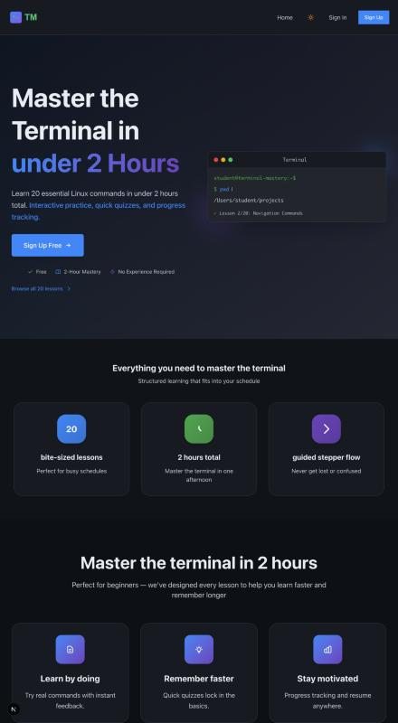 The hero reads well, the curriculum grid is clear ([screenshot](audit-screenshots/02-landing-curriculum.jpg)), and the terminal mockup is a good touch.
- **The lesson index is the strongest screen in the app** — search, filter by status, sort, clean progress summary. 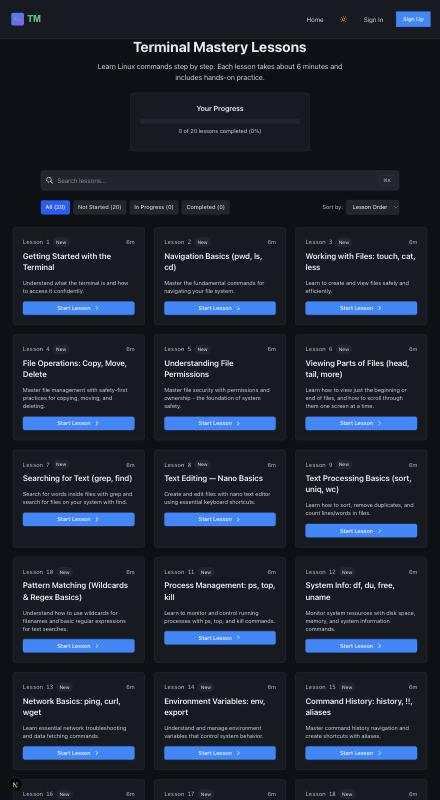
- **Both themes are complete and correct**, and the token architecture is well-designed where it's used.
- **Zero console errors** across every screen.

---

## Suggested order

1. **30 minutes:** delete `/certificate`; remove the fake `aggregateRating`; fix "join thousands"; fix the © year. (B7, R4 — the legal exposure)
2. **2 hours:** fix lesson 8 (B1), the `/completion` redirect (B2), delete the overlapping card (B3), fix the `Infinity` bug (B5).
3. **Half a day:** decide R1 — build validation or soften the copy. Everything downstream depends on this.
4. **The real work:** bring lessons 13–20 up to the standard of 1–5 (D1). This is what makes it worth promoting.
5. **Then:** quiz gating + persistence (B4), certificate names (B6), markdown via `MarkdownContent` (D4), token cleanup (D5).

---

### Audit environment

Run locally with a throwaway bypass, since the Supabase backend is deleted and all lessons are auth-gated. Not committed; revert with:

```bash
cd /Users/musabs1/Desktop/my-test-project/terminal-mastery
git checkout src/app/lessons/page.tsx 'src/app/lessons/[id]/page.tsx'
mv middleware.ts.disabled middleware.ts
# remove the NEXT_PUBLIC_AUDIT_MODE line from .env.local
```

Infrastructure status (unchanged from the earlier pass): Supabase project deleted, last Vercel deploy failed, no live URL, `terminal-mastery.com` never registered.
